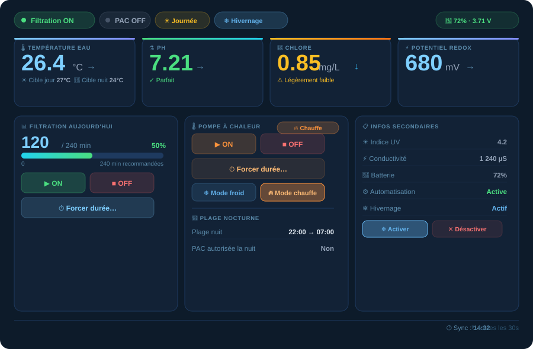
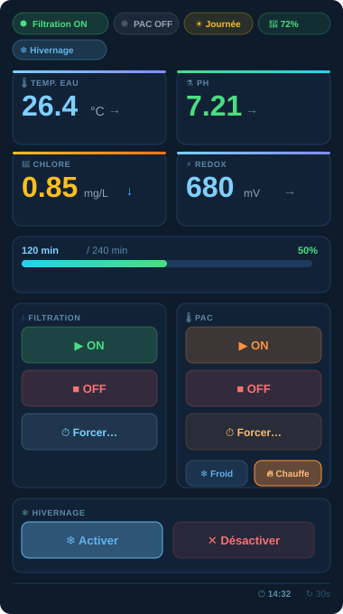

# Plugin Flipr Pilot


Plugin Jeedom de pilotage intelligent de piscine, combinant la sonde connectée **Flipr** et le contrôle **filtration / pompe à chaleur** via modules Zigbee (ou tout autre module Jeedom).

⚠️ **Note importante — Disponibilité de l'API Flipr**
Ce plugin repose entièrement sur l'API Flipr pour récupérer les données de la sonde. À l'heure de son développement, cette API fonctionne parfaitement. Cependant, la société Flipr ayant été placée en liquidation judiciaire fin 2025, l'auteur ne peut être et n'est en aucun cas responsable si l'API venait à devenir inaccessible ou à cesser de fonctionner.

---

## Fonctionnalités

### Sonde Flipr
- Récupération automatique **toutes les heures** :
  - Température de l'eau
  - pH : valeur, message d'état, déviation, secteur (`Medium`, `TooLow`, `TooHigh`…)
  - Chlore (désinfectant) : valeur, message, déviation, secteur
  - Potentiel Redox (ORP) en mV
  - Indice UV
  - Conductivité
- Batterie via l'endpoint dédié `/AnalysR/settings` : **pourcentage** et **tension** en volts
- Durée de filtration journalière via `/FiltrationTime/last`, avec fallback sur la règle **T°/2**
- Alerte active Flipr via `/currentAlert` — mise à jour toutes les **30 minutes** — vide si aucune alerte
- Date et heure de **dernière collecte** exposée comme commande info
- Token OAuth2 mis en **cache 55 minutes** — un seul appel d'authentification par heure
- Délai de **2 secondes** entre chaque appel API pour éviter le rate limiting Cloudflare

### Filtration
- Commandes **ON / OFF** et **Forcer X minutes**
- Trois sources de durée cible, configurables dans l'interface :
  - **API Flipr** *(défaut)* — valeur conseillée par la sonde, fallback T°/2 si indisponible
  - **Règle T°/2** — température ÷ 2 = heures de filtration
  - **Manuelle** — durée journalière en minutes saisie directement
- Suivi quotidien du temps de filtration effectué (table SQL dédiée)
- Arrêt automatique une fois la durée recommandée atteinte
- **Durée minimale de fonctionnement** configurable — protège la pompe contre les cycles trop courts
- Sécurité : la filtration ne peut pas s'arrêter automatiquement si la PAC est active
- **Détection des démarrages manuels** : si une commande état est liée, le passage physique 0→1 démarre automatiquement le comptage

### Pompe à chaleur (PAC)
- Commandes **ON / OFF** et **Forcer X minutes**
- Régulation automatique par **température cible** (jour / nuit) avec hystérésis configurable
- **Mode froid / Mode chauffe** : deux logiques d'hystérésis distinctes avec cibles dédiées — basculement via commande ou bouton sur la tuile
- Interlock : la PAC démarre automatiquement la filtration si elle est éteinte
- **Durée minimale de fonctionnement** configurable — protège le compresseur
- Arrêt automatique en plage nocturne (optionnel)
- **Détection des démarrages manuels** : même comportement que la filtration

### Hivernage / Protection antigel
- **Mode hivernage manuel** : activable depuis la tuile ou la page équipement — désactive la régulation normale (PAC, filtration quotidienne)
- En mode hivernage, la filtration démarre automatiquement si la température extérieure descend sous un **seuil configurable** (défaut 4 °C) et s'arrête à seuil + 1 °C
- Source de température : **sonde extérieure Jeedom** au choix, configurée dans l'onglet Liaisons
- La PAC n'est jamais démarrée en mode hivernage
- Commande info **« Antigel actif »** (binaire) et bandeau bleu ❄️ sur la tuile quand la protection est en cours

### États physiques (Zigbee)
- Liaison optionnelle vers les commandes **état** des modules physiques (filtration et PAC)
- Si liées : états lus depuis le module Zigbee toutes les 5 minutes, démarrages/arrêts manuels détectés automatiquement
- Si non liées : états déduits des commandes envoyées par le plugin (fallback interne)

### Surplus solaire (optionnel)
- Associez une commande info binaire « surplus électrique » : le plugin active filtration et PAC automatiquement lors des excédents de production photovoltaïque

### Plage nocturne
- Plages horaires début/fin nuit configurables
- Option pour autoriser ou interdire la PAC la nuit

### Interface visuelle

#### Tuile dashboard (desktop)

La tuile s'affiche automatiquement dans **Accueil > Dashboard > Pièce** à la place des commandes individuelles.



Elle présente :
- **Barre de statut** : état filtration (LED + chip), état PAC, plage horaire (jour &#9728;&#65039; / nuit &#127769;), niveau de batterie sonde, chip **❄️ Hivernage** (visible uniquement quand actif)
- **Bandeau d'alerte** Flipr (fond jaune si alerte active)
- **Bandeau antigel** (fond bleu ❄️ quand la protection antigel est en cours)
- **4 cartes métriques** : Température eau, pH, Chlore, Potentiel Redox — avec tendance sur 4 heures (↑ → ↓) et code couleur selon l'état (vert / orange / rouge)
- **Barre de progression** de filtration journalière (minutes effectuées / recommandées)
- **Boutons d'action Filtration** : ON / OFF + forcer durée (slider 5–480 min)
- **Boutons d'action PAC** : ON / OFF + forcer durée + boutons **❄️ Mode froid** / **🔥 Mode chauffe**
- **Infos nocturnes** : plage horaire, autorisation PAC la nuit
- **Infos secondaires** : Indice UV, Conductivité, Batterie, état automatisation, état hivernage avec boutons **Activer / Désactiver**
- **Actualisation automatique** toutes les 30 secondes — clic sur une métrique → historique Jeedom

#### Tuile mobile

Version compacte et tactile affichée dans la vue mobile de Jeedom.



Elle présente :
- Barre de statut compacte (chips réduits) — chip **❄️ Hivernage** visible quand actif
- **Bandeau antigel** (fond bleu ❄️ quand la protection est en cours)
- **Grille 2×2** des 4 métriques principales (valeur + tendance, sans sous-texte)
- Barre de progression filtration condensée
- **Boutons large format** : Filtration et PAC ON / OFF + forcer durée + modes PAC + **Activer / Désactiver hivernage**, optimisés pour le tactile
- **Actualisation automatique** toutes les 30 secondes

> La commande `Tuile dashboard` est créée automatiquement à la sauvegarde de l'équipement. Toutes les autres commandes sont masquées sur la tuile au profit de ce widget.

---

## Prérequis

- **Jeedom** v4.5 ou supérieur
- Compte **Flipr** (identifiants de l'application mobile Flipr)
- Un module Jeedom (Zigbee ou autre) exposant des commandes **ON/OFF** pour la filtration et la pompe à chaleur

---

## Configuration

### Onglet Flipr

| Champ | Description |
|-------|-------------|
| Login Flipr | Email du compte Flipr |
| Mot de passe Flipr | Mot de passe du compte Flipr |
| Numéro de série | Auto-détecté au premier enregistrement — bouton « Détecter » disponible |

Un bouton **Synchroniser maintenant** permet de déclencher manuellement la récupération des mesures sans attendre le cron horaire.

### Onglet Automatisation

#### Général

| Champ | Description | Défaut |
|-------|-------------|--------|
| Automatisation active | Active/désactive tout le pilotage automatique | Oui |

#### Durée de filtration

| Champ | Description | Défaut |
|-------|-------------|--------|
| Source de la durée | `API Flipr` / `Règle T°/2` / `Manuelle` | API Flipr |
| Durée manuelle (min) | Visible uniquement si source = Manuelle | 180 |

#### Protection équipements

| Champ | Description | Défaut |
|-------|-------------|--------|
| Durée mini filtration (min) | Temps minimum de fonctionnement avant arrêt automatique autorisé | 0 |
| Durée mini PAC (min) | Temps minimum de fonctionnement avant arrêt automatique autorisé | 0 |

> Les arrêts **manuels** (commandes Filtration OFF / PAC OFF) et les **timers forcés** ignorent toujours le minimum.

#### Températures cibles

| Champ | Description | Défaut |
|-------|-------------|--------|
| Température cible jour (°C) | Température visée en journée (mode chauffe) | 27 °C |
| Température cible nuit (°C) | Température visée la nuit (mode chauffe) | 24 °C |
| Cible refroidissement jour (°C) | Température visée en journée en mode froid | 28 °C |
| Cible refroidissement nuit (°C) | Température visée la nuit en mode froid | 28 °C |
| Hystérésis PAC (°C) | Écart toléré avant déclenchement/arrêt de la PAC | 0.5 °C |

#### Hivernage / Protection antigel

| Champ | Description | Défaut |
|-------|-------------|--------|
| Activer le mode hivernage | Désactive la régulation normale, active uniquement la protection antigel | Non |
| Seuil antigel (°C) | La filtration démarre si la température extérieure descend sous ce seuil | 4 °C |

> En mode hivernage, la PAC n'est jamais démarrée. La sonde de température extérieure est à configurer dans l'onglet **Liaisons**.

#### Plage nocturne

| Champ | Description | Défaut |
|-------|-------------|--------|
| Début nuit | Heure de début de la plage nocturne | 22:00 |
| Fin nuit | Heure de fin de la plage nocturne | 07:00 |
| PAC autorisée la nuit | Permet à la PAC de fonctionner pendant la plage nocturne | Non |

### Onglet Liaisons

Associez les commandes de vos équipements physiques. La sélection affiche le nom au format `#[Pièce][Équipement][Commande]#`.

| Liaison | Type | Description |
|---------|------|-------------|
| Sonde température extérieure | Info numérique | *(requis pour hivernage)* Commande température extérieure Jeedom |
| Commande ON filtration | Action | Démarre la pompe de filtration |
| Commande OFF filtration | Action | Arrête la pompe de filtration |
| État filtration | Info 0/1 | *(optionnel)* État réel du module — permet la détection des actions manuelles |
| Commande ON pompe à chaleur | Action | Démarre la PAC |
| Commande OFF pompe à chaleur | Action | Arrête la PAC |
| État PAC | Info 0/1 | *(optionnel)* État réel du module — permet la détection des actions manuelles |
| Surplus électrique | Info 0/1 | *(optionnel)* Excédent photovoltaïque |

---

## Commandes exposées

### Informations

| Nom | Description | Unité | Historisée |
|-----|-------------|-------|----------|
| Température eau | Température mesurée par la sonde Flipr | °C | ✅ |
| pH | Valeur de pH | — | ✅ |
| pH message | Message d'état Flipr (ex : « Parfait ») | texte | — |
| pH déviation | Écart par rapport à la valeur cible | — | — |
| pH secteur | Secteur de déviation (`Medium`, `TooLow`, `TooHigh`…) | texte | — |
| Chlore | Taux de chlore (désinfectant) | mg/L | ✅ |
| Chlore message | Message d'état Flipr (ex : « Trop faible ») | texte | — |
| Chlore déviation | Écart par rapport à la valeur cible | — | — |
| Chlore secteur | Secteur de déviation | texte | — |
| Potentiel Redox | ORP mesuré par la sonde | mV | ✅ |
| Indice UV | Indice UV au moment de la mesure | — | — |
| Conductivité | Conductivité de l'eau | µS | — |
| Batterie sonde | Niveau de batterie de la sonde | % | — |
| Tension batterie | Tension de la batterie | V | — |
| Filtration recommandée | Durée de filtration cible du jour | min | — |
| Dernière collecte | Date et heure de la dernière sync Flipr réussie | texte | — |
| Filtration état | État actuel de la filtration | 0/1 | ✅ |
| PAC état | État actuel de la pompe à chaleur | 0/1 | ✅ |
| Mode PAC | Mode actif de la PAC (`chauffe` ou `froid`) | texte | — |
| Antigel actif | Protection antigel en cours (mode hivernage) | 0/1 | — |
| Alerte | Alerte active remontée par Flipr | texte | — |
| Tuile dashboard | Widget d'affichage pour la vue Dashboard et Mobile | texte | — |

### Actions

| Nom | Description |
|-----|-------------|
| Filtration ON | Démarre la filtration |
| Filtration OFF | Arrête la filtration (bypass durée mini) |
| Forcer filtration | Démarre la filtration pour X minutes — slider 5–480 min |
| Forcer durée filtration | Modifie la durée journalière en mode **Manuelle** — slider 0–480 min (sans effet si la source est API Flipr ou T°/2) |
| PAC ON | Démarre la pompe à chaleur |
| PAC OFF | Arrête la PAC (bypass durée mini) |
| Forcer PAC | Démarre la PAC pour X minutes — slider 5–480 min |
| PAC mode froid | Bascule la régulation en mode refroidissement |
| PAC mode chauffe | Bascule la régulation en mode chauffage |
| Hivernage ON | Active le mode hivernage |
| Hivernage OFF | Désactive le mode hivernage |

> La commande `Tuile dashboard` est gérée automatiquement par le plugin et n'est pas destinée à être utilisée dans des scénarios. La visibilité et l'historisation des autres commandes sont configurables depuis l'onglet **Commandes**.

---

## Appels API Flipr

| Endpoint | Fréquence | Données |
|----------|-----------|----------|
| `POST /oauth2/token` | 1×/heure max (token en cache 55 min) | Token d'authentification |
| `GET /modules/{serial}/Survey/Last` | 1×/heure | Température, pH, Chlore, ORP, UV, Conductivité |
| `GET /modules/{serial}/FiltrationTime/last` | 1×/heure (mode API) | Durée de filtration conseillée |
| `GET /Modules/{serial}/AnalysR/settings` | 1×/heure | Batterie %, tension V, PlaceId |
| `GET /modules/{placeId}/currentAlert` | 1×/30 min | Alerte active Flipr |

Un délai de **2 secondes** est appliqué entre chaque appel pour respecter le rate limiting Cloudflare.

---

## Logique d'automatisation

Le cron tourne **toutes les 5 minutes** et applique les règles suivantes dans l'ordre :

```
0. Hivernage      — si mode hivernage actif : seule la protection antigel s'exécute
                    (temp. ext ≤ seuil → filtration ON ; temp. ext > seuil+1°C → filtration OFF)
                  — retour immédiat (étapes 1–7 ignorées)

1. Sync états     — lecture des états physiques depuis les modules Zigbee liés
                  — détection des démarrages/arrêts manuels → comptage automatique
2. Log quotidien  — incrémente le compteur de filtration/PAC du jour (table SQL)
3. Expirations    — fin d'un timer forcé → arrêt (bypass durée mini)
4. Sécurité       — PAC active sans filtration → démarre la filtration
5. PAC            — mode chauffe : temp. eau < (cible − hystérésis) → démarre la PAC
                               temp. eau > (cible + hystérésis) → arrête la PAC
                  — mode froid  : temp. eau > (cible + hystérésis) → démarre la PAC
                               temp. eau < (cible − hystérésis) → arrête la PAC
                  — plage nuit + PAC non autorisée   → arrête la PAC (si durée mini atteinte)
                  — données Flipr > 2h : démarrage PAC bloqué, arrêt toujours autorisé
6. Filtration     — durée cible non atteinte + journée → maintient/démarre la filtration
                  — durée cible atteinte + PAC éteinte → arrête la filtration (si durée mini atteinte)
7. Surplus        — surplus détecté → démarre filtration + PAC si eau < température cible
```

---

## Logs

Le plugin écrit dans le fichier `/var/www/html/log/fliprpilot` (visible dans Jeedom → Analyse → Logs).

| Niveau | Contenu |
|--------|--------|
| `INFO` | Démarrages/arrêts filtration et PAC, sync Flipr réussie, détection de démarrages manuels |
| `WARNING` | Erreurs API non bloquantes (rate limiting, endpoint indisponible), commande introuvable |
| `ERROR` | Erreurs bloquantes (authentification échouée, JSON invalide) |
| `DEBUG` | Trace complète des appels API (méthode, chemin, code HTTP, durée ms), décisions d'automatisation avec valeurs numériques, comptage quotidien filtration/PAC |

Exemple de sortie DEBUG :

```
→ API GET /modules/F3B39C1C/Survey/Last
← API GET /modules/F3B39C1C/Survey/Last | HTTP 200 (342ms)
PAC — T°eau: 22.4°C | cible: 27.0°C (±0.5) | seuil ON: 26.5 | seuil OFF: 27.5 | état: OFF | nuit: non
PAC → démarrage (T°eau 22.4°C < seuil ON 26.5°C)
Filtration — cible: 180min | effectuée: 45min | restante: 135min | état: ON | PAC: ON | nuit: non
Filtration → maintien (135min restantes à effectuer)
Comptage — filtration: 45min/180min (25%) | PAC: ON | filtration état: ON
```

---


## Compatibilité

Smart, Luna, Atlas, Raspberry Pi, Docker, DIY, Mobile

---

## Licence

AGPL v3 — Auteur : Dimitri23
